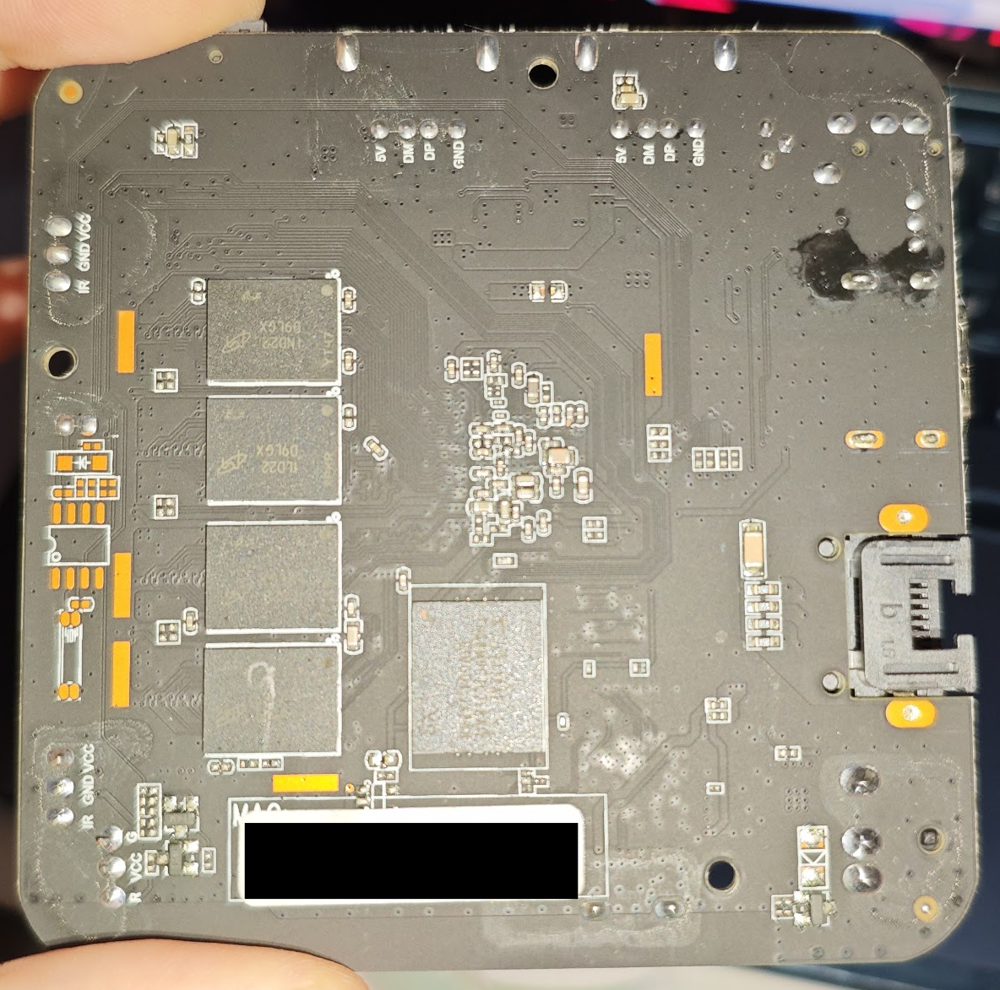
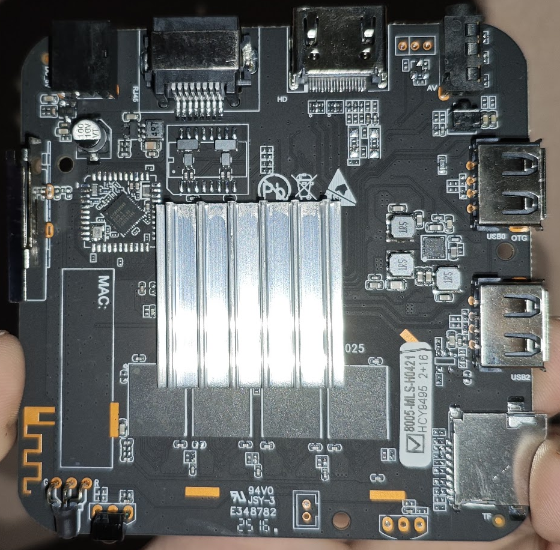
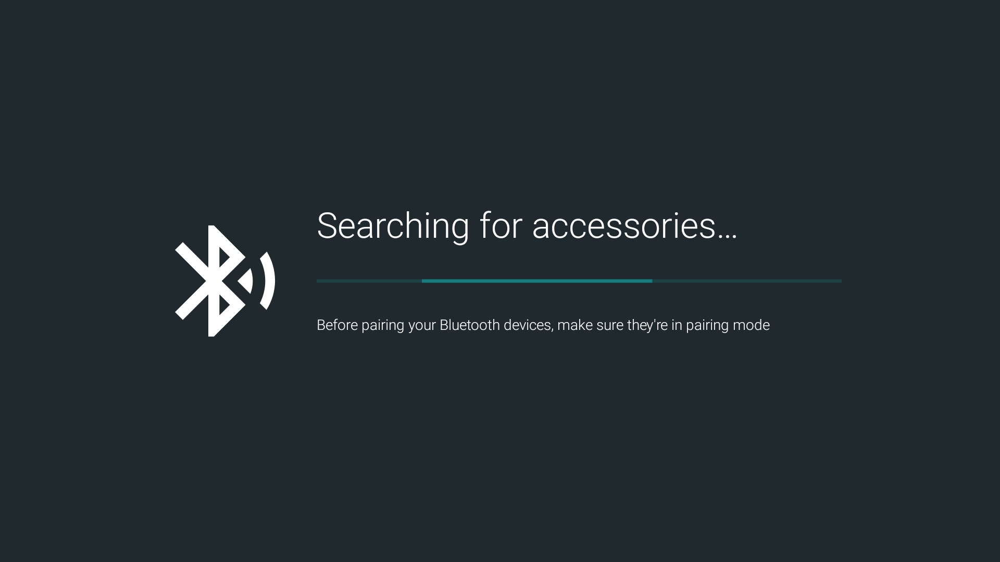
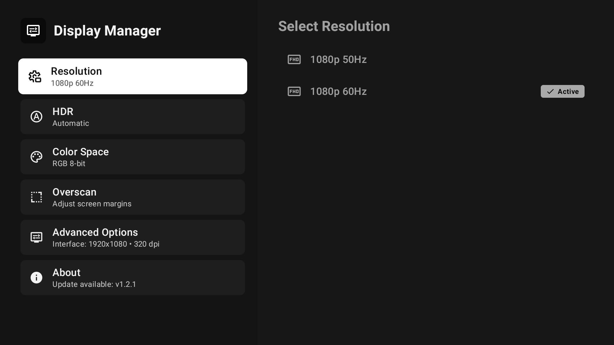
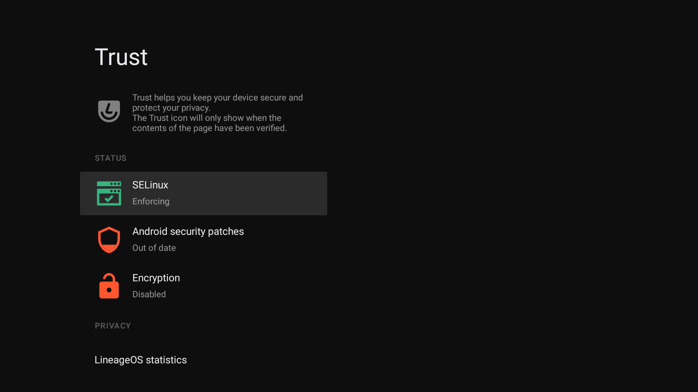
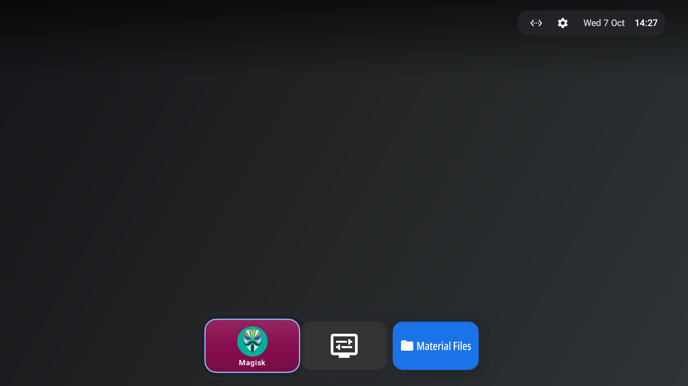
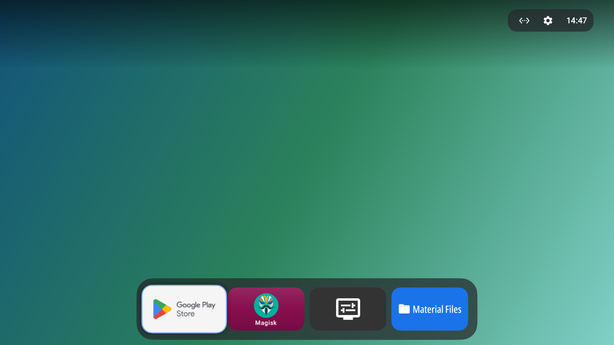

# LineageOS TV 18.1 (H96Max Allwinner H313)


Custom Android TV ROM for **Allwinner H313** SoC TV boxes (especially `H96 Max`).

>Your warranty is now void. I am not responsible for bricked devices, dead SD cards, thermonuclear war, or you getting fired because the alarm app failed. Please do some research if you have any concerns about features included in this ROM before flashing it! YOU are choosing to make these modifications, and if you point the finger at me for messing up your device, I will laugh at you.

## Features

- Based on LineageOS 18.1 (Android TV 11, API 30) ARM32 Binder64  GSI.
- Magisk integrated into boot ramdisk.
- SELinux **Enforcing**.
- Play Integrity **BASIC** pass.
- Many system optimizations.

## HW Specification

| Component | Specification |
| :--- | :--- |
| **SoC** | Allwinner H313 (Quad-core ARM Cortex-A53 @ up to 1.35 GHz) |
| **GPU** | ARM Mali-G31 MP2 (OpenGL ES 3.2) |
| **RAM** | 2 GB |
| **Storage** | 16 GB eMMC |
| **Video Output** | HDMI 2.0a (up to 4K @ 60fps), AV (CVBS 3.5mm jack) |
| **Connectivity** | Wi-Fi (2.4 GHz / 5 GHz), Ethernet 10/100M RJ45 |
| **Bluetooth** | Bluetooth 4+  |
| **Ports** | 2x USB 2.0 (1x Host, 1x OTG), MicroSD card slot, IR receiver |
| **Power** | DC 5V / 2A |





## Installation

### Download ROM

Three build variants are available:

- **`vanilla`** : Clean LineageOS experience without Google Services.
- **`gms_core`** : Core minimal Google services (Play Store).
- **`gms`** : Full Google Android TV experience (Play Store, GBoard, Leanback Launcher, Google Assistant, Backdrop, Google Cast...).

`vanilla` and `gms_core` variants are using [Couchy Launcher](https://f-droid.org/en/packages/com.conreo.couchytv/) as default launcher.

### Clean Flash

The `.img` file is a complete Allwinner firmware package flashable via [OpenixSuit](https://github.com/YuzukiTsuru/OpenixSuit/) (or **PhoenixSuit** / **LiveSuit**) using USB FEL mode:

1. Download and open OpenixSuit.
2. Select your downloaded `.img` file in the **Firmware Selection** box.
3. Put the H96Max into **FEL mode**:
   - Disconnect the power cable.
   - Insert a toothpick or plastic probe into the **AV port** to press and hold the internal recovery button.
   - While holding the button, connect the power cable and wait 5 seconds before stopping holding the recovery button.
   - Connect the H96Max to your PC using a **USB-A to USB-A cable** plugged into the **USB OTG port** (it is the USB port which is **NOT** next to the sdcard slot).
4. On OpenixSuit in flash configuration, choose **Partition Erase Flash** (**WARNING: THIS WILL WIPE YOUR DATA**).
5. Wait for the flashing progress to reach 100%. The device will reboot automatically.

> *After installation, please wait 1 to 2 minutes on first boot for the system to settle and let the background pre-installer configure system components.*

### Post-install

- Pair the Bluetooth voice remote at first boot by holding down **`LEFT`** and **`RIGHT`** simultaneously until the LED starts blinking. LineageOS will automatically pair the remote.
- Open Magisk (with `Sideload Launcher`) after installation to finish Root setup.
- To adjust display settings use the pre-installed `Display Manager` app.

## Known issues
- **No Widevine L1** (obviously)
- **Broken Google Cast**: Google Cast receiver keys are device-specific and not certified on generic Allwinner boards. Cast works only with apps with no verification (VLC for instance)
- **No Audio Passthrough**: Raw bitstream passthrough (IEC61937) is disabled by default to prevent audio issues, PCM stereo downmix is recommended.

## Gallery






### `vanilla`


### `gms_core`


### `gms_full`


## Build

### Prerequisites

Ensure the following tools are installed :

- `android-tools` (provides `simg2img`, `img2simg`)
- `lpmake`
- `e2fsprogs` (`e2fsck`, `resize2fs`, `debugfs`)
- `python3`

### Build ROM

To build a specific variant (available: `vanilla`, `debug`, `gms_core`, `gms_full`):

```bash
./build.sh --variant vanilla
```

To build all configured variants sequentially:

```bash
./build.sh --all
```

The resulting flashable `.img` and its `.sha256` checksum will be generated inside the `output/` directory.

